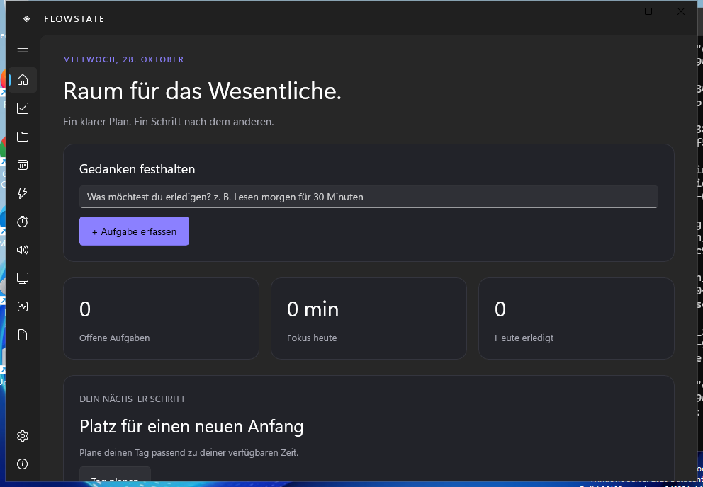

# Flowstate

**Your time. Your focus. Your flow.**

Native, lokale Windows-11-Produktivitätsanwendung mit WinUI 3. Implementiert anhand des bereitgestellten Flowstate-Konzepts. Der Repository-Name `flowwstate` ist der vorhandene Name auf GitHub.

**Entwicklungsstand 0.1.0-beta.3 – keine Stable-Version.** Der vollständige PDF-Funktionsumfang ist noch nicht abgenommen. Die genaue Abgrenzung steht in [docs/status.md](docs/status.md).



Echter Screenshot der installierten App aus der Windows-CI bei kleiner Bildschirmauflösung.

## Installation

Windows 11 x64. [Releases](https://github.com/747elias/flowwstate/releases) enthalten nach erfolgreicher Veröffentlichung `Flowstate-Setup-<Version>-win-x64.exe` und `SHA256SUMS.txt`.

1. Installer herunterladen, optional SHA-256 mit `Get-FileHash` vergleichen.
2. **Nur für mich** ist Standard und benötigt keine Administratorrechte.
3. **Für alle Benutzer** fordert die notwendigen Administratorrechte an.
4. App über das Startmenü öffnen. Es wird kein Konto benötigt.

Installer sind **unsigniert**. Windows kann einen unbekannten Herausgeber anzeigen. Die Prüfsumme ist keine Herausgebersignatur. Details: [Installation](docs/installation.md).

## Enthalten

- Aufgaben mit Prioritäten, Status, Projekten, Tags, Kontexten, Notizen, Checklisten, Abhängigkeiten, Dauer, Mindestdauer, Energiebedarf und Wiederholungen; Suche, Filter, Duplizieren, Archiv und Sammelaktionen.
- Projekte mit Fortschritt und Zeitübersicht.
- Tages-/Wochenraster, Monatskalender und Agenda; manuelle Termine/Timeboxing, Aufgaben per Drag & Drop, Verschieben, Konfliktwarnung, editierbare Dauer.
- Deterministisches AutoPlan: Heute, morgen, sieben Tage, freies Zeitfenster und Quick Session. Vorschau, Übernahme und Undo. Manuelle/fixierte Einträge bleiben erhalten.
- Persistenter Fokus-Timer, Pomodoro, Deep Work, eigene Dauer, Stoppuhr, Pausen, Protokollierung je Aufgabe, kompakte Fensteransicht.
- White/Brown/Pink Noise mit Mixer und sanftem Start/Stop; eigene WAV/MP3/FLAC-Dateien in Schleife.
- Workspaces mit bestätigten Starts lokaler Programme/Dokumente/Ordner und HTTP(S)-URLs.
- Quick Capture über Strg+Alt+Leertaste, lokale Erkennung deutscher Datums-/Dauerangaben mit anschließendem Editor zur Kontrolle.
- Dashboard, Fokusstatistiken, Tagesrückblick, Dark/Light/System-Theme, Autostart und Tray.
- SQLite/EF Core, Migrationen, JSON-Export/Import und Backups; keine Telemetrie.
- Tägliche optionale und manuelle Prüfung stabiler GitHub-Releases; HTTPS, Repository-Prüfung und SHA-256 vor Installation.

## Erste Schritte

1. Im Dashboard eine Aufgabe eingeben, beispielsweise `Lesen morgen für 30 Minuten`.
2. Unter **Aufgaben** Priorität, Projekt und Dauer ergänzen.
3. **AutoPlan** öffnen, verfügbare Zeit auswählen und Plan berechnen. Vorschau prüfen und übernehmen.
4. Eine Aufgabe im **Focus Studio** bearbeiten; Ende oder Abbruch speichert die tatsächliche Fokuszeit.
5. Unter **Analytics** und **Tagesrückblick** den Tag betrachten.
6. Unter **Einstellungen → Daten & Privatsphäre** regelmäßig sichern.

## Entwicklung

.NET 10 SDK. Windows-Build benötigt Windows 11/Windows Server mit Windows SDK und WinUI-Build-Werkzeugen. Die Kernlogik und Datenbanktests laufen auch unter Linux.

```powershell
dotnet test tests/Flowstate.Tests -c Release
dotnet publish src/Flowstate.App -c Release -p:Platform=x64 -r win-x64 --self-contained true -o artifacts/app
.\scripts\build.ps1
```

`build.ps1` führt Tests, Publish und Inno Setup aus. Die App enthält die benötigten Laufzeitdateien. Node.js und ein Webserver sind zur Benutzung nicht erforderlich.

[Architektur](docs/architecture.md) · [Tests](docs/testing.md) · [Status](docs/status.md) · [Updates](docs/updater.md)

## Datenschutz und Lizenz

Daten: `%LOCALAPPDATA%\Flowstate`. Keine Aufgabeninhalte werden an GitHub übertragen. Die optionale Update-Prüfung ist die einzige eingebaute Netzwerkanfrage. HTTP(S)-Links werden nur nach Benutzeraktion geöffnet. Exporte/Backups sind unverschlüsselt.

Eine Lizenz für den eigenen Projektcode ist noch nicht festgelegt. Die Veröffentlichung des Quellcodes allein erteilt keine zusätzliche Nutzungslizenz. Abhängigkeiten behalten ihre jeweiligen Lizenzen; siehe [Drittanbieter](docs/third-party.md).
